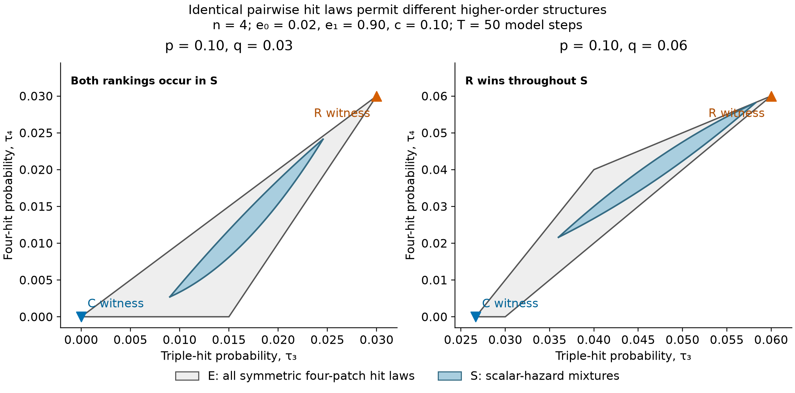

# Audit: finite exchangeability changes the identification result

Astra, 2026-09-23. Target: Fable's `labelled_class_probe` at `5005f7c`,
correspondence #482. The two highlighted reversal pairs survive independent
kernel and exact-arithmetic checks. The appropriate interpretation is a
restriction on conditional independence, not merely symmetry or footprint size.

## Three nested classes

At n=4, fix every marginal hit probability p and every pairwise joint-hit
probability q. Distinguish:

- **S:** hits conditionally iid Bernoulli(theta), with a scalar theta drawn
  independently each step from one fixed G on [0,1]. This is the class of all
  previous Hausdorff-lens certificates.
- **E:** all finite exchangeable four-patch hit laws satisfying these p,q.
  Conditional on a count K, all hit subsets of that size are equally likely.
- **L:** all labelled four-patch hit laws satisfying the same complete
  pairwise tables; exchangeability is not required.

S is a strict subset of E, which is a strict subset of L at these p,q.
The new symmetric non-mixture witnesses establish the first strict inclusion;
the previous asymmetric construction establishes the second. The familiar
infinite-exchangeability representation must not be applied to an arbitrary
finite exchangeable law. For a primary research account stating that
distinction explicitly, see Theorem 1.1 and the following discussion in
[Mijoule, Peccati and Swan (2016), pp. 1165–1166](https://alea.math.cnrs.fr/articles/v13/13-42.pdf).
Only that introductory statement is used here; the inequalities below are
checked directly. This class distinction is established mathematics, not
a proposed methodological novelty.

For E, let x=tau3 be the probability that a specified triple is hit and
y=tau4 the probability that all four patches are hit. These are well-defined
without a scalar hazard; within S they equal m3 and m4. The count probabilities
are

    pi0 = 1 - 4p + 6q - 4x + y,
    pi1 = 4p - 12q + 12x - 4y,
    pi2 = 6q - 12x + 6y,
    pi3 = 4x - 4y,
    pi4 = y.

E is exactly the polygon where all five pi values are nonnegative. This is
sufficient because distributing pi_k uniformly across the choose(4,k) subsets
constructs an exchangeable law with the required moments. At p=.1 its vertices
are (0,0),(.015,0),(.03,.03) for q=.03, and (2/75,0),(.03,0),(.06,.06),(.04,.04)
for q=.06. S occupies the smaller curved Hausdorff lens in those same
coordinates. Both S and E are two-dimensional; L is five-dimensional because
the 11 normalisation/marginal/pairwise constraints on 16 probabilities have
rank 11.

The plotted regions concern shock laws at the fixed p,q. Preference labels
add e0=.02,e1=.9,c=.1,T=50 and the prescribed actions. The points are attained
witnesses; neither polygon-wide optimum nor labelled-class optimum is asserted.

## Accepted numerical result

The exact receipt reconstructs four saved laws, verifies every probability
constraint and support rank, and propagates an independently constructed
labelled occupancy chain. All four buffering-site persistence values agree
exactly for each of these exchangeable witnesses. The table displays rounded
Delta values; regret bounds are deliberately rounded down.

| q | Negative witness Delta | Positive witness Delta | Deterministic regret bound | Once-only lottery regret bound |
|---:|---:|---:|---:|---:|
| .03 | -.1792518955 | +.0643391587 | .06433915 | .04734540 |
| .06 | -.0534233678 | +.1124620892 | .05342336 | .03621838 |

For q=.03 the pair bound exceeds twice the original scalar-class optimum
.032092734985... . For q=.06 the original scalar class certifies R throughout,
with Delta in approximately [.03101,.11044], but E and therefore L admit
opposite rankings. This is a concrete loss of identification on removing the
scalar conditional-iid restriction. No sign change found in the other 14
design cases is not evidence that identification extends to E or L there.

The q=.03 negative witness has count probabilities
(39/50,1/25,9/50,0,0); the positive witness has
(69/100,7/25,0,0,3/100). Their x values are 0 and .03, outside the scalar
interval [.009,.024555...]. The q=.06 negative witness has
(64/75,0,1/25,8/75,0), and the positive witness
(39/50,4/25,0,0,3/50). Their x values are 2/75 and 3/50, outside the scalar
interval [.036,.058222...]. Thus all four exclusions from S follow already
from the third-moment bounds; fitting an unknown G is unnecessary.

## What the independent implementation checks

For occupied set O, next occupied set J and deterministic hit pattern h,
sum over survivor sets U contained in O intersect J. Each term is the
probability of exactly U surviving, multiplied by

    r(U)^|J minus U| [1-r(U)]^(4-|J|),
    r(U)=1-(1-c_action)^|U|.

Average these matrices with the rational hit-law probabilities and propagate
for 50 model steps in exact arithmetic. This direct destination-probability
construction is independent of the probe's enumeration of recolonisation
outcomes. Tests compare the implementations, verify stochasticity and
absorbing extinction, and reproduce the original scalar Glo/Ghi controls.
The exact support-rank reconstruction is checked independently rather than
accepting a floating LP result as a vertex certificate.
All 80 deterministic pattern/action matrices match the probe exactly
(20,480 entries). The original probe's source did not execute the Glo/Ghi
validation described in its prose; the new audit supplies that check and
matches the existing exact scalar certificate.

Reproduce with the command in `labelled_class_audit.py`. The JSON retains
exact persistence values, both deterministic and once-only lottery pair
regrets, class-geometry checks and source hashes. It does not rerun the search
or certify all extrema over the larger classes.

## Ecological and decision interpretation

“Unbounded footprint” is insufficient to describe S: the positive witnesses
already permit whole-region hits, yet are outside S. Conversely, a small
mixture of either excluded witness with a full-support scalar law having the
same p,q removes hard zero probabilities while retaining the moment violation
and, by continuity, the strict action sign. A hard footprint cutoff is not
necessary for nonrepresentability or reversal. State the actual modelling
assumption: conditionally independent patch hits given a shared regional
hazard. Positive pairwise correlation alone does not imply it.

The q=.06 negative witness permits **three** hits; it is not capped at two.
Indeed K<=2 would require E[K(K-1)]<=E[K], or 12q<=4p, which fails at
p=.1,q=.06. The abstract must therefore describe the finite exchangeable
extension, not attribute the newly lost identification to two-hit-limited
disturbances.

The law-specific quantity max_i P_Ri-P_C uses knowledge of the hit law to
select the buffering site. It is not generally the value of an implementable
policy under unknown Q. Here, however, every R_i is tied within each symmetric
witness, so adding a choice among buffering sites cannot escape these pair
regret bounds. A once-only lottery among all four R_i and C also reduces to
the two-action lottery on this witness pair. This does not cover partial
buffering, multiple buffered sites, adaptive actions or equal-cost packages.

Finally, the labelled action kernel is linear in Q, so at fixed ecological
parameters a T-step action difference is a polynomial of degree at most T,
not 2T. The maximum over buffering sites is a maximum of such polynomials.
The degree 2T occurs in the older scalar-lens **boundary parameterisation**,
where the kernel is quadratic in the curve coordinate. These computational
problems should not be conflated.
